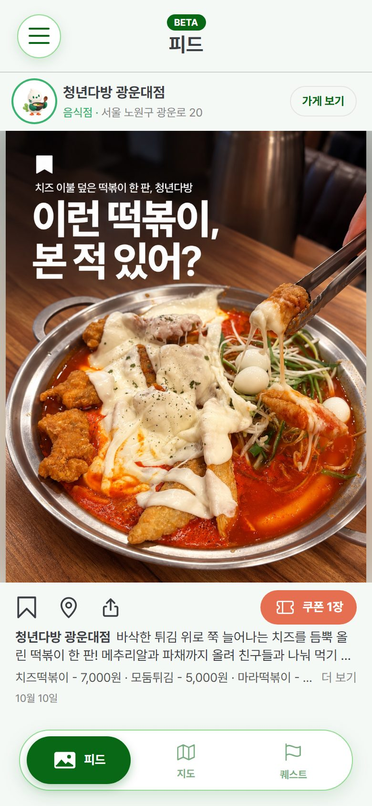
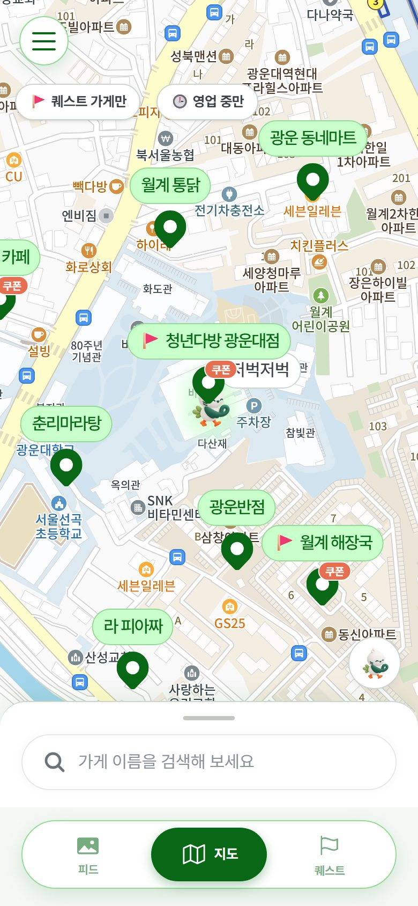
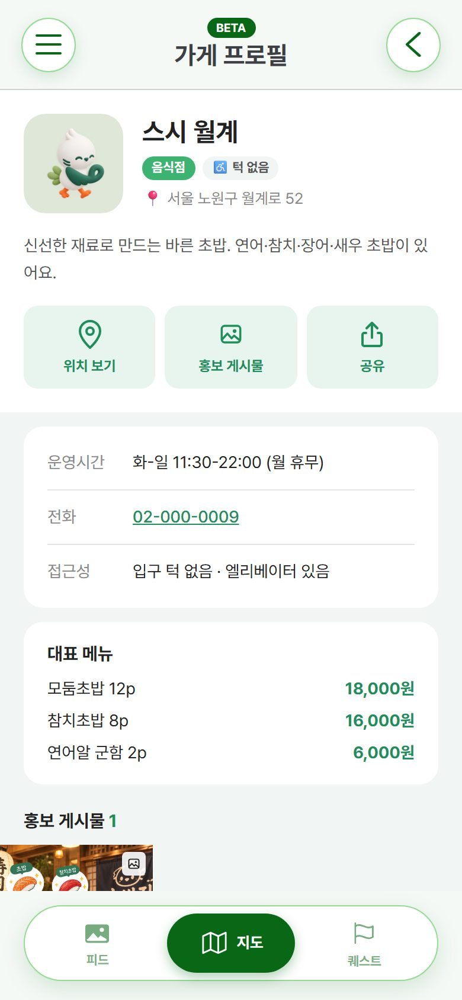
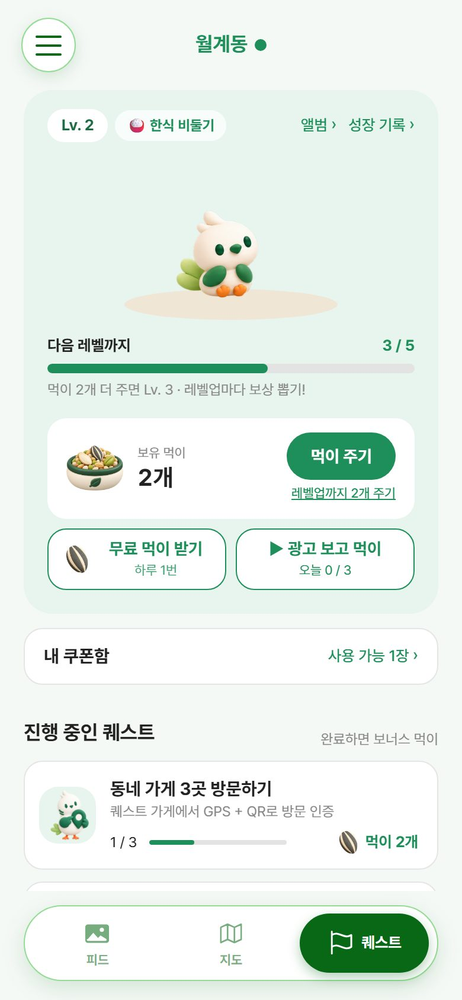
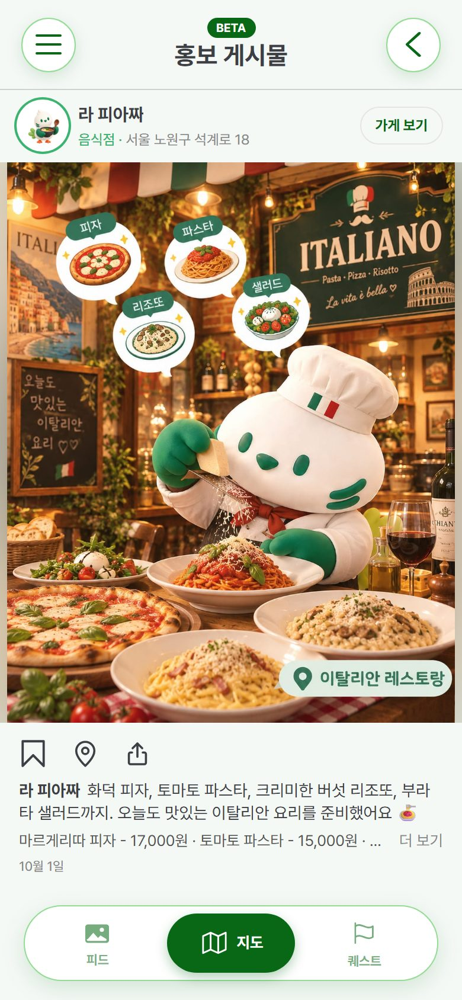
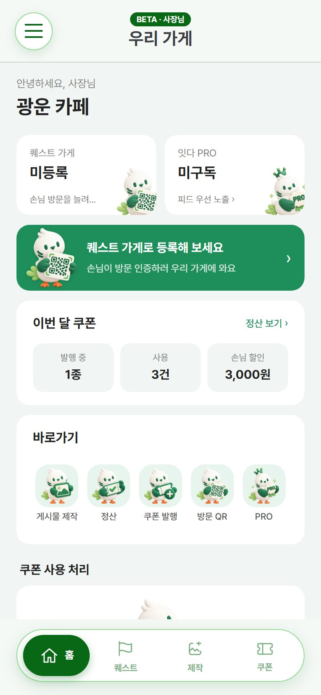
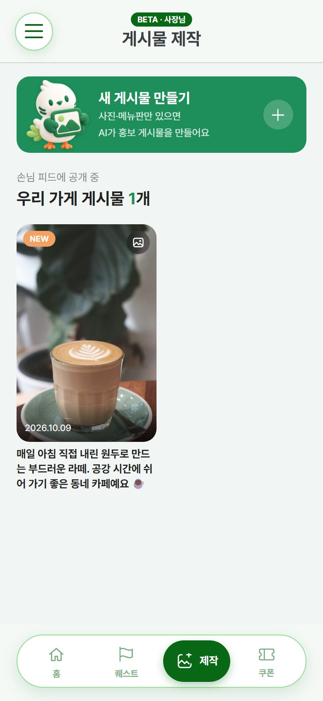
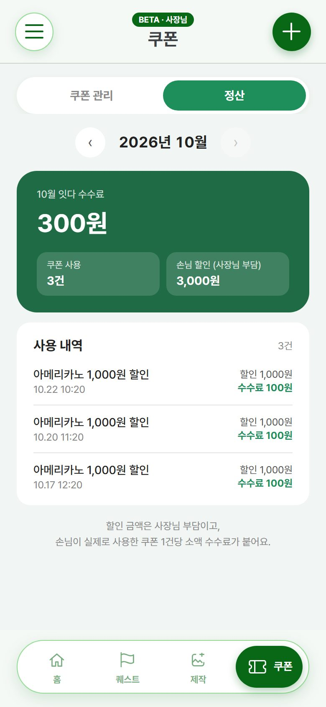

# 🕊️ Itda (잇다) — Connecting a Neighborhood's Small Shops and Residents

**English** | [한국어](README.ko.md)

> A mobile web app that turns one photo into an AI promo post for a local shop, puts every shop on a live neighborhood map, and rewards residents for actually walking in.

Built at the **2026 KW Hackathon** (Team 10 · 컴미컴) for Wolgye 1-dong, Nowon-gu, Seoul, and demoed live at the hackathon exhibition (Oct 13, 2026). Visitors scanned a QR code on our poster and tried the app right there on their phones.

**🔗 Live app:** https://itda-kappa.vercel.app (tap **"베타 테스터로 체험하기"** to try every feature without signing up)
**📦 Team repository:** [2026-KW-HACKATHON/10_Commicom](https://github.com/2026-KW-HACKATHON/10_Commicom)

---

## 📸 Screenshots

| Feed | Map | Store | Pigeon quest |
| :---: | :---: | :---: | :---: |
|  |  |  |  |

| Mascot promo post | Owner home | AI post creation | Coupon settlement |
| :---: | :---: | :---: | :---: |
|  |  |  |  |

---

## 📖 The Problem

Small shops in Wolgye 1-dong have no time or staff for promo copy, card news or social media, so residents rarely hear about a new menu or a discount in time and default to franchises. Itda closes that gap from both sides:

- **Owners** upload a photo and a menu board → AI writes the promo post, and they can issue coupons and join visit quests.
- **Residents** browse a photo feed and a live map of nearby shops, then visit shops in person to raise a pigeon and win coupons.
- **Accessibility** is part of every store profile (step-free entrance, elevator), and the UI uses large text and buttons.

---

## 👥 Team & My Role

A three-person team: 임아연, **김준영 (me)**, 장서현.

I wrote **73 of the repository's 94 commits** (about 26,000 lines). Specifically:

- **The entire client app** (React + TypeScript): customer and owner modes, feed, map, store profiles, quests, coupons, owner center, AI post creation flow, admin screen.
- **Backend domains** (Spring Boot): store registration, quests, pigeon growth and rewards, coupons and settlement, PRO subscription, post publishing and management, scraps, events, notices, feedback, admin APIs, plus the API spec.
- **Infrastructure**: AWS EC2 server, Vercel hosting with an API proxy, GitHub Actions CI/CD, production database migrations.
- **The exhibition beta mode** described below.

My teammate 장서현 built the backend foundation (sign-up/login with JWT, the store list API, the common response format) and the **AI generation pipeline** (Amazon Bedrock image generation, Polly TTS, FFmpeg, OCR, S3).

---

## ✨ Key Features

**For residents**
- Instagram-style photo feed of shop posts, with PRO shops shown first, plus scraps and sharing
- Kakao Maps neighborhood map with category pins, coupon badges, quest-shop flags and an "open now" filter that reads each shop's business hours
- Quests verified by **GPS + a daily QR code** at the shop; each visit earns pigeon feed
- Raise a pigeon: every level-up draws a reward coupon that a shop owner put into the reward pool

**For shop owners**
- AI promo post from food and menu-board photos (up to 4 owner photos per post)
- Issue coupons, redeem them by code at the counter, and see a monthly settlement
- Register as a paid quest shop to get visitors, and a PRO plan for priority feed placement and post revisions

**For the operators**
- Admin screen: sign-ups, stores, coupons, reward pool, beta feedback, notices
- In-app events and notices board, plus an early-owner promotion (first 10 shops that offer reward coupons get PRO and quest-shop listing free for 30 days)

---

## 🛠 Tech Stack

| Area | Stack |
| --- | --- |
| Client | React 19, TypeScript, Vite, Tailwind CSS 4, TanStack Query, Zustand, React Router 7, react-kakao-maps-sdk |
| Server | Java 21, Spring Boot 4.1, Spring Security (JWT), Spring Data JPA, MySQL (H2 locally), Spring Mail |
| AI & media | Amazon Bedrock, Amazon Polly, FFmpeg, OCR, S3 + CloudFront |
| Infra | AWS EC2 (t2.micro) with systemd, Vercel (static + serverless API proxy), GitHub Actions |

```
Phone browser ──► Vercel (React app + /api proxy function) ──► EC2: Spring Boot ──► MySQL
                                                                      └──► S3 / CloudFront, Bedrock, Polly
```

---

## 🔧 What I Solved

**A beta mode that runs the whole app without a server**
For the exhibition, visitors had to try every feature in seconds, with no sign-up and without filling the production database with test data. I had already built a browser-side mock API (stored in `localStorage`) that mirrors the real API's rules and error codes. A single "beta tester" switch reroutes every feature to it and logs the visitor in as a demo owner account, so one phone can play both customer and owner. As a result the server received almost no traffic during the exhibition no matter how many people scanned the QR code.

**A fair reward economy with an empty-pool fallback**
Level-up rewards come from coupons that owners offer. The draw is **weighted by remaining quantity**, so a shop that offers 30 coupons is three times as likely to be drawn as one that offers 10. At launch no shop had offered any coupons yet, so when the pool is empty the server issues a **3-week voucher** instead. A badge tells the resident when a coupon becomes available to exchange it for, and if the voucher expires it turns into 4 pigeon feed. The weighted draw is shared by the server and the mock layer, so beta mode behaves like production.

**Keeping a 1 GB server alive**
The production server ran on an AWS t2.micro (1 GB RAM, 8 GB disk). It ran out of memory and the OS hung, which took sign-up down. I added 2 GB of swap, capped the Java heap, and moved the app under systemd so it restarts by itself. Later the disk filled up with old jar backups and the deploy upload failed. The deploy job now keeps a single backup and stops early if less than 700 MB is free.

**CI/CD with automatic rollback**
A push to `dev` builds the jar and connects to EC2 with a temporary key through **EC2 Instance Connect**, so no SSH key is stored in GitHub. The job then uploads the jar, restarts the service, waits for startup, and **restores the previous jar if the new one fails to start**. A separate workflow deploys the client to Vercel.

**Smaller bugs found in production**
- Photo uploads from phones failed with a misleading "cannot reach the server" message. The cause was Vercel's 4.5 MB limit on function request bodies. Images are now resized in the browser before upload, and a 413 response shows a clear message.
- Admins needed to test owner features without their test store appearing to real customers. Stores registered by an admin are now hidden from the map, the feed and the reward pool, and don't take an early-owner promotion slot.

---

## 💡 What I Learned

- Shipping to real users, even for one day at an exhibition, exposes problems you never hit locally: memory, disk, request size limits, email provider lockouts.
- Investing early in a mock API that follows the real spec paid off twice: the client didn't have to wait for the server, and it later became the exhibition's beta mode.
- Small infrastructure safeguards (swap, auto-restart, rollback, a disk check) matter more than they look when one person is on call.
